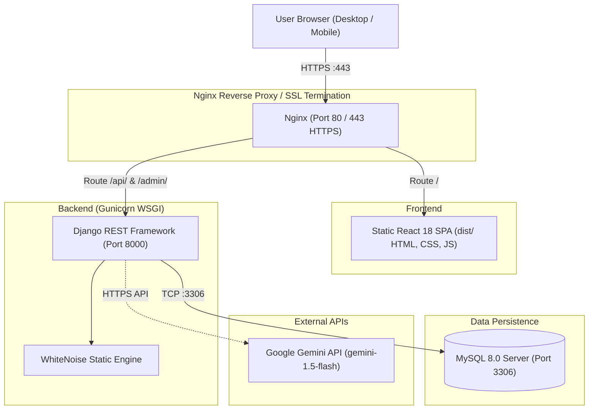

# TechNotes – Production Deployment Guide 🚀

This document outlines the step-by-step procedures for deploying **TechNotes Technical Learning Platform** to production environments.

---

## 🏗️ Production Architecture



---

## 🔒 1. Pre-Deployment Security Checklist

Before pushing to production, verify your backend `.env`:

| Variable | Development | Production | Notes |
|---|---|---|---|
| `DEBUG` | `True` | `False` | **CRITICAL:** Never run with `DEBUG=True` in production. |
| `SECRET_KEY` | default | `A strong random string` | Generate using `python -c "import secrets; print(secrets.token_urlsafe(50))"` |
| `ALLOWED_HOSTS` | `*` | `yourdomain.com,api.yourdomain.com` | Restrict to your actual server domain/IP. |
| `CORS_ALLOWED_ORIGINS`| `http://localhost:5173` | `https://yourdomain.com` | Restrict to your frontend production domain. |
| `DB_HOST` | `127.0.0.1` | `localhost` or MySQL container/host | MySQL host |
| `DB_PASSWORD` | dev password | Strong generated password | Secure MySQL password |
| `GEMINI_API_KEY` | optional | `AIzaSy...` | Your Google Gemini API Key |

---

## 🐳 Option 1: Docker Compose Deployment (Recommended)

*Fastest and most consistent across AWS EC2, DigitalOcean Droplet, Linode, or any Ubuntu server.*

### Prerequisites
- An Ubuntu 22.04 or 24.04 server with **Docker** and **Docker Compose** installed.

```bash
# Install Docker on Ubuntu
sudo apt update
sudo apt install -y docker.io docker-compose-v2
sudo systemctl enable --now docker
```

### Steps

1. **Clone the repository onto the server:**
   ```bash
   git clone <your-repo-url> /opt/technotes
   cd /opt/technotes
   ```

2. **Configure production environment:**
   Create `.env` in the root or edit `docker-compose.yml`:
   ```bash
   nano .env
   ```
   Add:
   ```env
   SECRET_KEY=generate-a-strong-secret-key-here
   GEMINI_API_KEY=your-gemini-api-key-here
   ```

3. **Launch the stack with a single command:**
   ```bash
   sudo docker compose up -d --build
   ```

4. **Verify running containers:**
   ```bash
   sudo docker compose ps
   ```
   You should see:
   - `technotes_db` (healthy)
   - `technotes_backend` (running on port 8000)
   - `technotes_frontend` (built React SPA)
   - `technotes_proxy` (listening on port 80)

5. **Access the application:**
   Open your browser at `http://your-server-ip/` or your domain. Everything (Frontend UI, REST API, Database, and Admin) is fully operational.

---

## 🖥️ Option 2: Traditional Ubuntu VPS (Nginx + Gunicorn + Systemd + MySQL)

### Step 1: Install System Dependencies
```bash
sudo apt update && sudo apt upgrade -y
sudo apt install -y python3-pip python3-venv python3-dev mysql-server nginx curl git build-essential default-libmysqlclient-dev pkg-config
```

### Step 2: Configure MySQL
```bash
sudo mysql -u root
```
Run the following SQL commands:
```sql
CREATE DATABASE technotes_db CHARACTER SET utf8mb4 COLLATE utf8mb4_unicode_ci;
CREATE USER 'technotes_user'@'localhost' IDENTIFIED BY 'StrongProductionPassword123!';
GRANT ALL PRIVILEGES ON technotes_db.* TO 'technotes_user'@'localhost';
FLUSH PRIVILEGES;
EXIT;
```

### Step 3: Deploy Backend
```bash
# Clone to /var/www
sudo mkdir -p /var/www/technotes
sudo chown -R $USER:$USER /var/www/technotes
cd /var/www/technotes
git clone <your-repo-url> .

# Setup Python Virtual Environment
cd backend
python3 -m venv venv
source venv/bin/activate
pip install --upgrade pip
pip install -r requirements.txt

# Configure .env
cp .env.example .env
nano .env
```
Fill in the production values:
```env
SECRET_KEY=production-secure-random-key
DEBUG=False
ALLOWED_HOSTS=yourdomain.com,api.yourdomain.com,127.0.0.1
DB_NAME=technotes_db
DB_USER=technotes_user
DB_PASSWORD=StrongProductionPassword123!
DB_HOST=127.0.0.1
DB_PORT=3306
GEMINI_API_KEY=your-gemini-key
CORS_ALLOWED_ORIGINS=https://yourdomain.com
```

Run migrations, seed data, and collect static files:
```bash
python manage.py migrate
python seed_data.py
python seed_more_quizzes.py
python manage.py collectstatic --noinput
```

### Step 4: Configure Gunicorn Systemd Service
Create the service file:
```bash
sudo nano /etc/systemd/system/technotes.service
```
Paste:
```ini
[Unit]
Description=TechNotes Gunicorn Daemon
After=network.target mysql.service

[Service]
User=ubuntu
Group=www-data
WorkingDirectory=/var/www/technotes/backend
ExecStart=/var/www/technotes/backend/venv/bin/gunicorn \
          --workers 3 \
          --bind 127.0.0.1:8000 \
          --timeout 120 \
          core.wsgi:application

Restart=always
RestartSec=5

[Install]
WantedBy=multi-user.target
```
Enable and start Gunicorn:
```bash
sudo systemctl daemon-reload
sudo systemctl enable --now technotes
sudo systemctl status technotes
```

### Step 5: Build Frontend
```bash
# Install Node.js (via NodeSource)
curl -fsSL https://deb.nodesource.com/setup_20.x | sudo -E bash -
sudo apt install -y nodejs

cd /var/www/technotes/frontend
# Create production environment
echo "VITE_API_URL=https://yourdomain.com/api/" > .env.production
npm install --legacy-peer-deps
npm run build
```
This outputs the optimized bundle into `/var/www/technotes/frontend/dist`.

### Step 6: Configure Nginx & SSL
Create an Nginx server block:
```bash
sudo nano /etc/nginx/sites-available/technotes
```
Paste:
```nginx
server {
    listen 80;
    server_name yourdomain.com www.yourdomain.com;
    client_max_body_size 50M;

    # Frontend React SPA
    root /var/www/technotes/frontend/dist;
    index index.html;

    location / {
        try_files $uri $uri/ /index.html;
    }

    # Django Backend REST API
    location /api/ {
        proxy_pass http://127.0.0.1:8000;
        proxy_set_header Host $host;
        proxy_set_header X-Real-IP $remote_addr;
        proxy_set_header X-Forwarded-For $proxy_add_x_forwarded_for;
        proxy_set_header X-Forwarded-Proto $scheme;
    }

    # Django Admin
    location /admin/ {
        proxy_pass http://127.0.0.1:8000;
        proxy_set_header Host $host;
        proxy_set_header X-Real-IP $remote_addr;
        proxy_set_header X-Forwarded-For $proxy_add_x_forwarded_for;
        proxy_set_header X-Forwarded-Proto $scheme;
    }

    # Static Files
    location /static/ {
        alias /var/www/technotes/backend/staticfiles/;
    }

    # Media Uploads
    location /media/ {
        alias /var/www/technotes/backend/media/;
    }
}
```

Enable site and restart Nginx:
```bash
sudo ln -s /etc/nginx/sites-available/technotes /etc/nginx/sites-enabled/
sudo nginx -t
sudo systemctl restart nginx
```

### Step 7: Enable Free SSL with Let's Encrypt Certbot
```bash
sudo apt install -y certbot python3-certbot-nginx
sudo certbot --nginx -d yourdomain.com -d www.yourdomain.com
```

---

## ☁️ Option 3: Cloud PaaS (Vercel + Render / Railway)

If you prefer managed cloud platforms:

### 1. Database (Aiven / PlanetScale / Railway MySQL)
- Create a free or starter MySQL 8.0 instance on [Railway](https://railway.app) or [Aiven](https://aiven.io).
- Note down: `DB_NAME`, `DB_USER`, `DB_PASSWORD`, `DB_HOST`, `DB_PORT`.

### 2. Backend on Render or Railway
- Connect your GitHub repo to [Render](https://render.com).
- Create a new **Web Service**.
- **Root Directory:** `backend`
- **Build Command:** `pip install -r requirements.txt && python manage.py migrate && python seed_data.py && python seed_more_quizzes.py && python manage.py collectstatic --noinput`
- **Start Command:** `gunicorn core.wsgi:application --bind 0.0.0.0:$PORT --workers 3`
- Add Environment Variables:
  - `DEBUG=False`
  - `SECRET_KEY=your-secret-key`
  - `DB_NAME`, `DB_USER`, `DB_PASSWORD`, `DB_HOST`, `DB_PORT`
  - `GEMINI_API_KEY=your-gemini-key`
  - `CORS_ALLOWED_ORIGINS=https://your-frontend.vercel.app`

### 3. Frontend on Vercel
- Connect your GitHub repo to [Vercel](https://vercel.com).
- **Root Directory:** `frontend`
- **Framework Preset:** `Vite`
- **Environment Variable:**
  - `VITE_API_URL=https://your-backend.onrender.com/api/`
- Click **Deploy**. Vercel will build and serve your global CDN React SPA automatically.

---

## 🔄 Maintenance Commands

```bash
# Restart backend service
sudo systemctl restart technotes

# View live backend logs
sudo journalctl -u technotes -f

# Pull updates and rebuild
git pull origin main
source venv/bin/activate
pip install -r requirements.txt
python manage.py migrate
sudo systemctl restart technotes
cd ../frontend && npm install && npm run build
```
